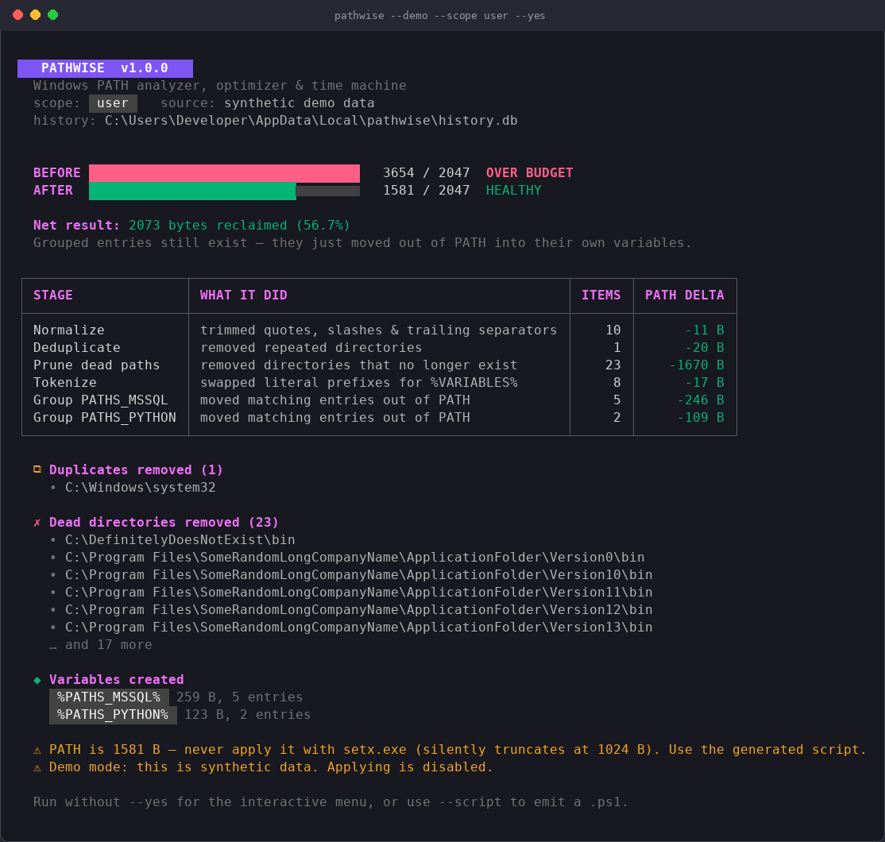
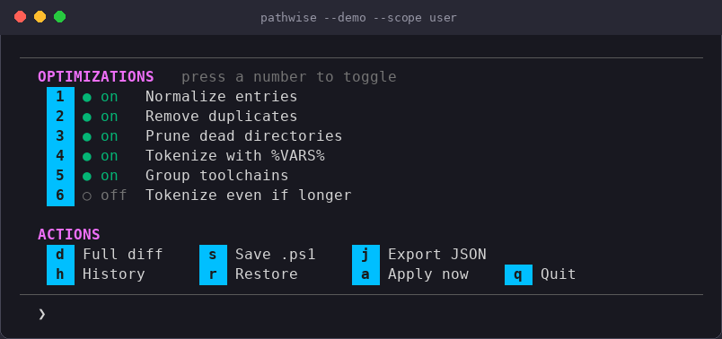
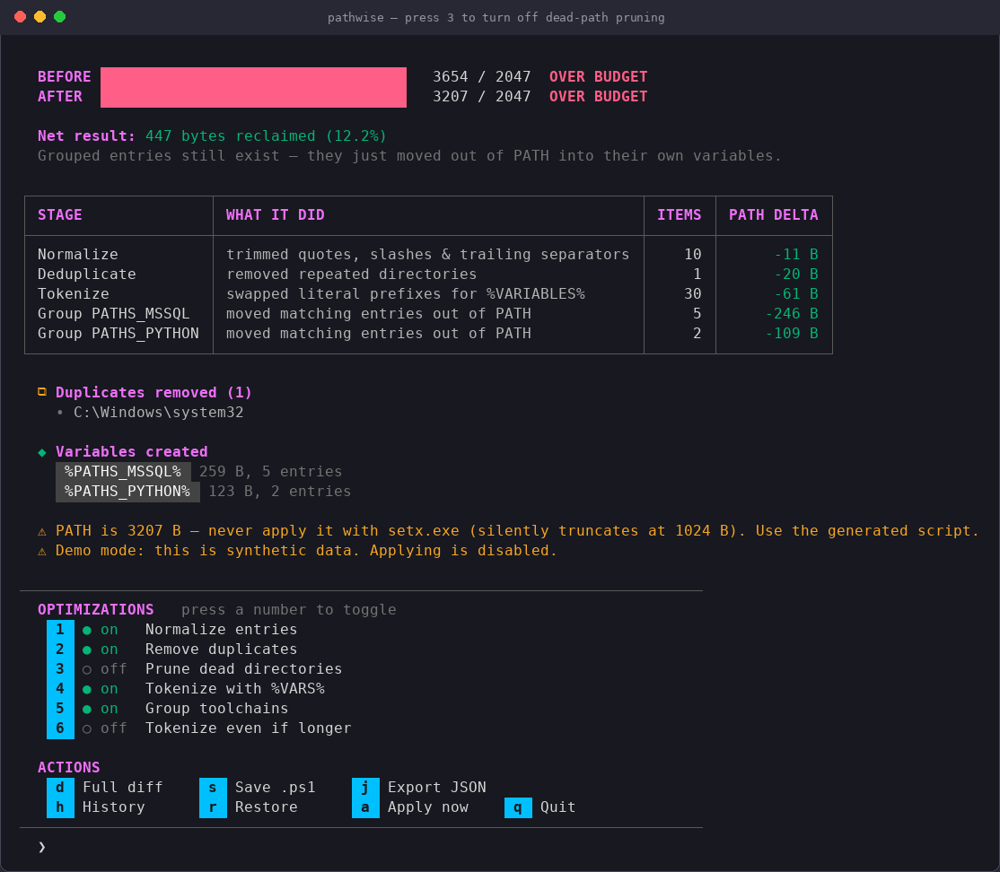
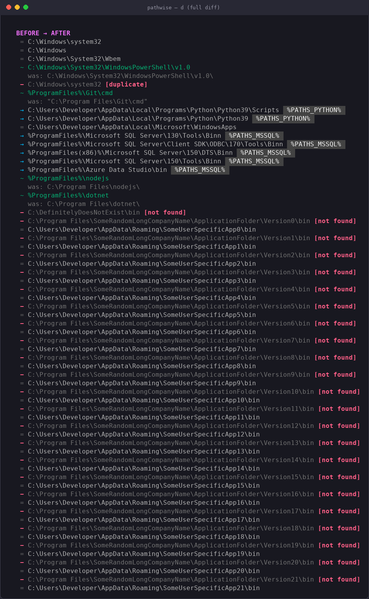
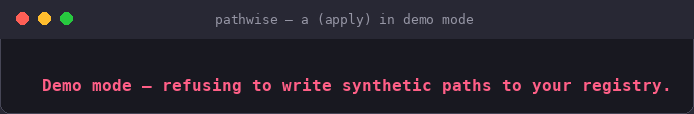
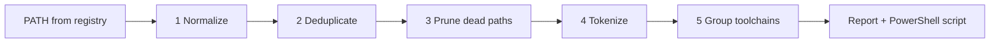

<div align="center">

# Pathwise

**Analyze, optimize and safely roll back your Windows `PATH`.**

[](https://github.com/<your-org>/pathwise/actions/workflows/ci.yml)


[](LICENSE)



</div>

---

`PATH` variables turn into landfills: duplicate entries, folders for software you uninstalled
years ago, and five different spellings of the same SDK directory. Eventually Windows silently
truncates the value, or `cmd.exe` and older tools choke on it.

Pathwise reads your real `PATH`, shows exactly what is safe to remove or rewrite, and lets you
apply the change **with a backup and an undo button**. Nothing is written to the registry until
you type a confirmation word.

## Contents

- [Highlights](#highlights)
- [Quick start](#quick-start)
- [Installation](#installation)
- [A tour of the interface](#a-tour-of-the-interface)
- [How the optimizer works](#how-the-optimizer-works)
- [Command-line reference](#command-line-reference)
- [Safety model](#safety-model)
- [Running outside Windows](#running-outside-windows)
- [Documentation](#documentation)
- [Development](#development)
- [License](#license)

## Highlights

- **Reads the real value.** `PATH` comes straight from the registry (`HKCU\Environment` or
  `HKLM\...\Environment`) *without* expanding `%VARIABLES%`, so round-trips never silently turn
  tokens into literal paths.
- **Five independent optimization stages** you can toggle live and watch the effect of.
- **A byte budget, not just a length.** Warns near 2047 bytes (where legacy tooling breaks),
  errors before the registry's hard 32767-byte limit, and always steers you away from `setx.exe`,
  which truncates at 1024 bytes.
- **Time machine.** Every run and every registry write is recorded in a local SQLite database,
  plus an independent `.reg` backup. Snapshots can be listed and restored later.
- **Three scopes:** `user` (no admin needed), `machine` (needs an elevated shell to apply) and
  `process` (the merged, read-only view your shell sees).
- **Demo mode** (`--demo`) runs everything against a synthetic, deliberately bloated `PATH`, so
  you can explore without touching your real environment.
- **Scriptable.** `--json` for machine-readable reports, `--script` to emit the exact PowerShell
  that would be run, `--yes` for non-interactive use.

## Quick start

```sh
# Try it without touching anything real
pathwise --demo

# Analyze your real user PATH, then walk through the interactive menu
pathwise --scope user

# Just print a report, no prompts
pathwise --scope user --yes

# Get the change as a PowerShell script instead of applying it yourself
pathwise --scope user --script cleanup.ps1
```

If you omit `--scope`, Pathwise asks which one you mean before doing anything.

## Installation

### Download a release (recommended)

Grab `pathwise_windows_amd64.exe` (or `arm64`) from the
[Releases page](https://github.com/<your-org>/pathwise/releases). Each release ships a
`checksums.txt` so you can verify the download:

```powershell
Get-FileHash .\pathwise_windows_amd64.exe -Algorithm SHA256
```

### Build from source

Requires Go 1.26+. There is no CGo dependency, so cross-compiling works too.

```sh
git clone https://github.com/<your-org>/pathwise.git
cd pathwise
go build -o pathwise.exe .

# or, from Linux/macOS:
GOOS=windows GOARCH=amd64 go build -o pathwise.exe .
```

## A tour of the interface

> The screenshots below are real output from `pathwise --demo`, which uses synthetic data.

### 1. The analysis report


At the top, two gauges show the `PATH` size **before** and **after** against your budget. The
table lists every stage that changed something and how many bytes it saved. Below it you will
find the exact duplicates and dead directories that were removed, plus any `%PATHS_*%`
variables that were created.

### 2. The interactive menu



Press a number to toggle an optimization. The whole pipeline re-runs immediately, so you see the
effect before committing to anything.

### 3. Toggling a stage



Here pruning was switched off with `3`. Dead directories stay in `PATH`, the saving shrinks, and
the report updates instantly.

### 4. Full diff



`d` shows every entry before and after: `−` removed (with the reason), `→` moved into a group
variable, `~` rewritten (with the original underneath) and `=` untouched.

### 5. Safe by default



In demo mode, and for process scope, Pathwise refuses to write anything. For real scopes,
applying requires typing `APPLY` after a snapshot has been taken.

## How the optimizer works



| Stage | What it does |
|---|---|
| **Normalize** | Trims quotes and whitespace, collapses `/` and `\\`, strips trailing separators |
| **Deduplicate** | Removes repeated directories (case-insensitive, first occurrence wins, so order is preserved) |
| **Prune dead paths** | Removes directories that no longer exist. Permission errors and unresolvable `%VARS%` are skipped, never guessed |
| **Tokenize** | Swaps literal prefixes such as `C:\Program Files` for `%ProgramFiles%`, only when it actually shortens the entry |
| **Group toolchains** | Hoists noisy SDK directories (SQL Server, .NET, Java, Node, Python) into their own `PATHS_*` variables when two or more entries match |

Grouped entries are not deleted. They move out of `PATH` into a variable such as
`%PATHS_MSSQL%`, which `PATH` then references.

## Command-line reference

| Flag | Default | Description |
|---|---|---|
| `--scope` | *(prompted)* | `user`, `machine` or `process` |
| `--budget` | `2047` | Target maximum `PATH` length in bytes (max `32767`) |
| `--demo` | `false` | Use synthetic bloated data (cannot apply) |
| `--yes` | `false` | Non-interactive: analyze, print the report, exit |
| `--json` | `false` | Print a JSON report and exit |
| `--script <file>` | | Write the PowerShell script to a file and exit, without running it |
| `--no-prune` | `false` | Keep directories that no longer exist on disk |
| `--no-color` | `false` | Disable ANSI colors (also honours `NO_COLOR` and `TERM=dumb`) |
| `--width` | `76` | Output width for tables and bars (min `20`) |
| `--db <path>` | `%LOCALAPPDATA%\pathwise\history.db` | History database location |
| `--no-history` | `false` | Disable snapshots and run logging entirely |
| `--history` | `false` | Show snapshot and run history, then exit |
| `--restore <id>` | | Restore a snapshot by ID, then exit |
| `--gc <n>` | | Delete automatic snapshots beyond the newest `n` per scope, then exit |

Invalid flag values exit with status `2`; runtime failures exit with `1`.

## Safety model

Writing to the registry is the one operation worth being paranoid about.

1. **Analysis never writes.** No flags, `--yes`, `--json` and `--script` only read.
2. **Typed confirmation.** Applying needs `APPLY`; restoring needs `RESTORE`.
3. **A snapshot before every write**, for both apply and restore.
4. **A `.reg` backup beside every non-automatic snapshot** in `%LOCALAPPDATA%\pathwise\backups`,
   so you can recover by double-clicking a file even without Pathwise.
5. **PowerShell with `-Type ExpandString`**, never `setx.exe`, so `%VARIABLES%` survive.
6. **New shells are notified** via a `WM_SETTINGCHANGE` broadcast (already-open terminals still
   need to be reopened).
7. **Process scope is read-only**, since writing a merged view back would corrupt Machine or User.

## Running outside Windows

Registry access, snapshots and script execution are Windows-only. Elsewhere Pathwise still
builds and runs, but it analyzes the current process's `PATH` regardless of `--scope`, can print
reports (`--yes`, `--json`), can emit the PowerShell script with `--script` for use on a Windows
machine, and refuses to apply or restore. That makes it easy to develop the optimizer on
macOS or Linux.

## Documentation

| Guide | What is in it |
|---|---|
| [User guide](docs/USER_GUIDE.md) | Step-by-step walkthrough, reading the report, apply and restore, troubleshooting |
| [Architecture](docs/ARCHITECTURE.md) | Source layout, data model, pipeline internals, history schema, testing |

## Development

```sh
go build -o pathwise.exe .
go vet ./...
go test ./...
```

`pathutil.go` and `engine.go` contain no registry, filesystem-mutating or terminal I/O, so their
tests (`pathutil_test.go`, `engine_test.go`, `tokens_test.go`) run on any OS and use
`t.TempDir()` and `t.Setenv()` so nothing outside the test process is touched. CI runs
format, vet, test and build on Windows and Ubuntu; pushing a `v*` tag builds `amd64` and `arm64`
binaries and publishes a GitHub Release with checksums.

## License

MIT. See [LICENSE](LICENSE).
