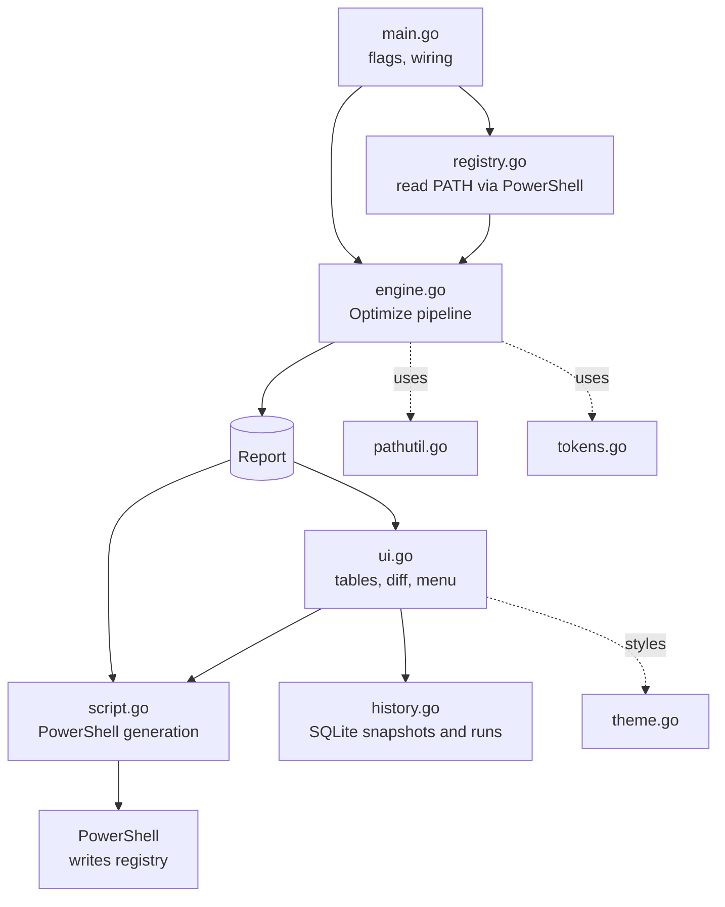

# Architecture

Pathwise is a single `package main` Go program, split into files by responsibility. This document
is for contributors: it describes how the pieces fit together and why they are shaped the way
they are.

## Overview



The important design decision: **the engine is pure.** `Optimize()` takes a raw `PATH` string
and `Options`, and returns a `Report`. Everything that touches the registry, the terminal or the
database lives elsewhere, which is what makes the engine testable on any OS.

## Source layout

| File | Responsibility |
|---|---|
| `main.go` | Flag parsing and validation, scope selection, mode dispatch (`--history`, `--restore`, `--gc`, `--json`, `--script`, interactive) |
| `types.go` | Constants (`defaultBudget`, `hardLimit`, `setxLimit`, `managedPrefix`), `Scope`, and the `Entry` / `Stage` / `Options` / `Report` model |
| `engine.go` | `Optimize()`: the five-stage pipeline |
| `pathutil.go` | Pure string helpers: `hasPathPrefix`, `expandWin`, `expandWinChecked`, `normalizePath`, `dedupKey`, `buildPath` |
| `tokens.go` | Special-folder token detection and the toolchain grouping rules |
| `registry.go` | Reading `PATH` and managed variables from the registry (via PowerShell); `demoPath()` |
| `history.go` | SQLite-backed `Store`: snapshots, runs, garbage collection, `capture()` |
| `script.go` | Generating the PowerShell apply and restore scripts |
| `ui.go` | Rendering (gauges, tables, findings, diff, history) and the interactive menu |
| `theme.go` | Terminal styling built on `lipgloss`, including the usage bar |

## Data model

```go
type Entry struct {
    Original string // the segment as read
    Value    string // the segment after the stages ran
    Group    string // e.g. "PATHS_MSSQL" when hoisted
    Dropped  bool
    Reason   string // "duplicate" | "not found"
    Exists   bool
    Checked  bool   // existence was actually verified
}

type Stage  struct { Name, Detail string; Before, After, Touched int }
type Report struct { Scope; Original, Optimized string; OriginalLen, OptimizedLen, Budget int
                     Stages []Stage; Groups map[string]string; GroupOrder []string; Entries []*Entry }
```

A `Report` is both the in-memory result the UI renders and the JSON document emitted by
`--json` (`Original`, `GroupOrder` and `Entry.Checked` are excluded from JSON).

Entries are never deleted from the slice. Stages mark them (`Dropped`, `Group`, a new `Value`),
which is what lets the diff view explain every decision.

## The pipeline

`Optimize()` splits the raw string on `;`, then runs each enabled stage through a small `stage()`
wrapper that measures the rebuilt `PATH` length before and after. A stage only appears in the
report if it touched something or changed the length.

1. **Normalize.** `normalizePath` trims whitespace and quotes, converts `/` to `\`, collapses
   repeated backslashes (preserving a leading `\\` for UNC paths) and strips trailing separators
   (keeping drive roots like `C:\`).
2. **Deduplicate.** Keys come from `dedupKey`: expand known variables, normalize, lower-case.
   First occurrence wins because `PATH` order is significant.
3. **Prune.** Uses `expandWinChecked`. If an entry references a variable this process does not
   have, the entry is skipped and left unverified. Only `os.IsNotExist` marks an entry dead, so
   permission errors never cause removal.
4. **Tokenize.** Tokens are sorted longest-value-first so `%ProgramFiles(x86)%` wins over
   `%ProgramFiles%`. A replacement is applied only if it is shorter (or `AllowGrowth` is set).
   `LOCALAPPDATA`, `APPDATA` and `USERPROFILE` are *user-only* and skipped in machine scope.
   Matching is boundary-aware: `C:\Windows` does not match `C:\WindowsApps`.
5. **Group.** One stage per rule in `defaultGroups`. Entries whose lower-cased value contains a
   keyword are collected; if fewer than two match, the grouping is undone (one entry is not
   worth a variable). Otherwise the members are stored in `Report.Groups[var]` and `%var%` is
   appended to `PATH`.

| Variable | Keywords |
|---|---|
| `PATHS_MSSQL` | `sql server`, `mssql`, `azure data studio`, `odbc` |
| `PATHS_DOTNET` | `\dotnet`, `visual studio`, `msbuild`, `\.net` |
| `PATHS_JAVA` | `\jdk`, `\jre`, `\java`, `maven`, `gradle` |
| `PATHS_NODE` | `nodejs`, `\npm`, `\yarn`, `pnpm` |
| `PATHS_PYTHON` | `python`, `anaconda`, `miniconda` |

All variables created by Pathwise share the `PATHS_` prefix (`managedPrefix`). That prefix is
what Restore uses to know which variables it is allowed to delete.

### Adding a grouping rule

Append to `defaultGroups` in `tokens.go`:

```go
{managedPrefix + "RUST", []string{`\.cargo`, "rustup"}},
```

Add a case to `engine_test.go` covering both the "two or more match" and "only one matches"
paths.

## Scopes and the registry

`Scope` maps to a hive via `hive()` (for `reg export`) and `psPath()` (for PowerShell
providers). Only `user` and `machine` are `writable()`. Process scope and non-Windows platforms
read `os.Getenv("PATH")` instead of the registry.

Values are read **without** expanding `%VARIABLES%`, otherwise a round trip would silently
replace tokens with literal paths.

## Script generation

`buildScript(rep)` produces a script in this order: `#requires`, strict mode, a `reg export`
backup, group variables, `Path`, then the `WM_SETTINGCHANGE` broadcast. Every write uses
`Set-ItemProperty ... -Type ExpandString`. Strings go through `psQuote`, which single-quotes and
doubles embedded quotes, so entries containing `'` cannot break out of the string.

`buildRestoreScript` writes the snapshot's `Path` and variables back and `Remove-ItemProperty`s
any managed variable that did not exist at snapshot time.

`runScript` writes the script to a temp file (mode `0600`), runs
`powershell -NoProfile -ExecutionPolicy Bypass -File`, and deletes it afterwards.

## History store

SQLite via `modernc.org/sqlite` (pure Go, no CGo). One connection, WAL journal, 5 s busy
timeout, foreign keys on.

```sql
snapshots(id, taken_at, scope, kind, path_raw, length, reg_file, note, host)
snapshot_vars(snapshot_id -> snapshots.id ON DELETE CASCADE, name, value)
runs(id, ran_at, scope, before_len, after_len, applied, options, report_json)
```

- `capture()` reads live registry state, collects managed variables, and for every kind except
  `auto` also exports a `.reg` file to `<dataDir>\backups`.
- `captureIfChanged()` runs at startup and records an `auto` snapshot only if the registry value
  differs from the latest stored one, so the database does not fill with duplicates.
- `GC(n)` deletes `auto` snapshots beyond the newest `n` per scope. Manual, apply and restore
  snapshots are never collected.

History failures are never fatal: `main` prints a warning and continues with `store == nil`.

## Terminal UI

`ui.go` uses hand-rolled tables (`renderTable`) built on `lipgloss.Width`, so styled cells align
correctly and there is no dependency on `lipgloss/table`. Colors are disabled by `--no-color`,
`NO_COLOR` or `TERM=dumb`. The menu is a plain read-eval loop on stdin; toggling a stage calls
`Optimize()` again with the new `Options` against the *original* string, so toggles never
compound.

Interactive mode requires a TTY on stdin. With `--yes`, `--json`, `--script` or piped input,
Pathwise prints the report and exits.

## Testing

| File | Covers |
|---|---|
| `pathutil_test.go` | Prefix matching, variable expansion, normalization, dedup keys, path building |
| `tokens_test.go` | Token detection and user-only handling |
| `engine_test.go` | Each stage alone and in combination |

Tests use `t.TempDir()` for real-versus-dead directories and `t.Setenv()` for token detection,
so nothing outside the test process is touched. They run on any OS; CI runs them on Windows and
Ubuntu, along with `gofmt`, `go vet` and `go build`.

```sh
go test ./... -v
```

## Release process

Pushing a tag such as `v1.0.0` triggers `.github/workflows/release.yml`: it builds
`pathwise.exe` for `windows/amd64` and `windows/arm64` (`CGO_ENABLED=0`, `-trimpath`,
`-ldflags "-s -w"`), zips each with the README and LICENSE, generates `checksums.txt` and
publishes a GitHub Release with generated notes. The workflow can also be run manually to get
binaries as artifacts without publishing.

```sh
git tag v1.0.0 && git push origin v1.0.0
```

## Design principles

- **Never guess.** Unresolvable variables and permission errors are skipped, not treated as
  evidence that something is dead.
- **Reversible by construction.** A snapshot and `.reg` file exist before any write.
- **Read freely, write deliberately.** Analysis modes cannot write; writing needs a typed word.
- **Keep the core pure** so it can be tested without Windows.
